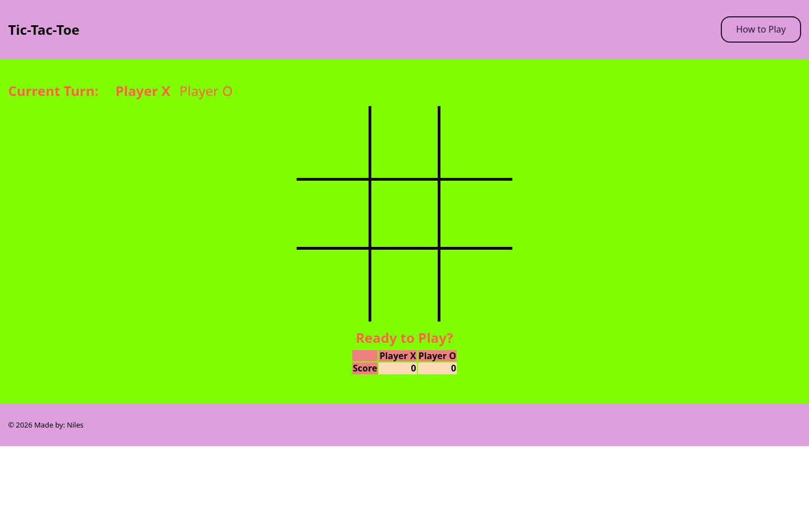
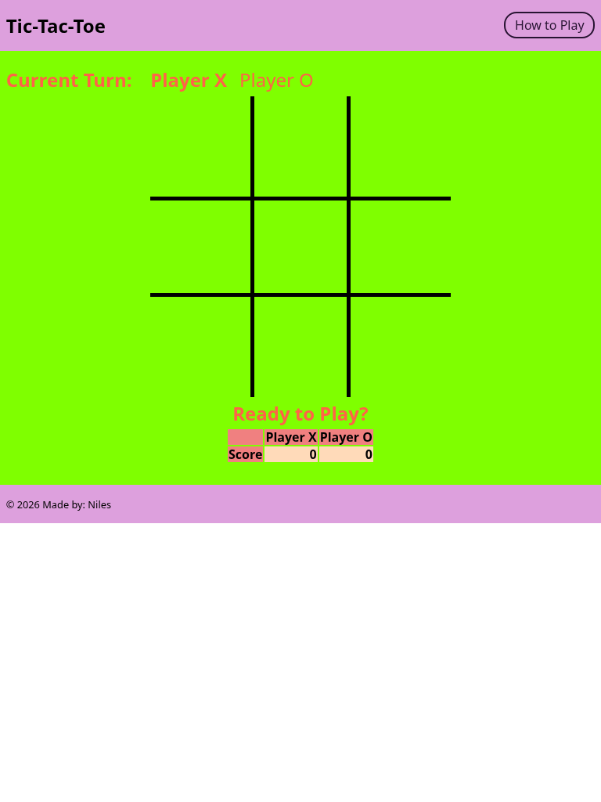
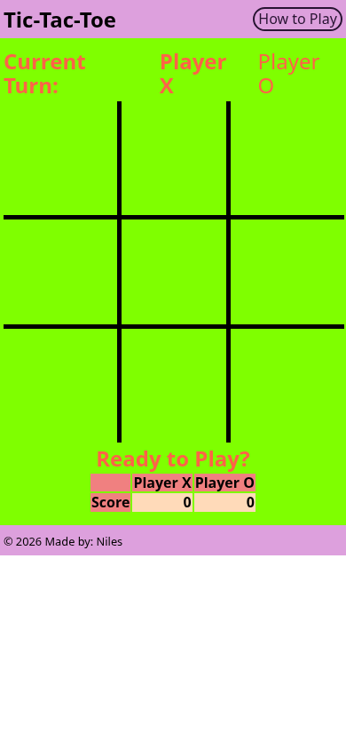

# Tic-Tac-Toe

A two-player Tic-Tac-Toe game with turn tracking, win and tie detection, and scorekeeping.

## Overview

Tic-Tac-Toe lets two players take turns placing X and O on a three-by-three board.

The application tracks whose turn it is, checks the board after each move, detects wins and ties, updates player scores, and resets the board for the next round.

## Features

- Two-player local gameplay
- X and O turn tracking
- Prevention of moves on occupied squares
- Win detection across rows, columns, and diagonals
- Tie detection
- Player score tracking across rounds
- Automatic board reset after a win or tie

## Technologies

<p>
  <a href="https://developer.mozilla.org/en-US/docs/Web/HTML" title="HTML">
    
  </a>
  &nbsp;
  <a href="https://developer.mozilla.org/en-US/docs/Web/CSS" title="CSS">
    
  </a>
  &nbsp;
  <a href="https://developer.mozilla.org/en-US/docs/Web/JavaScript" title="JavaScript">
    
  </a>
</p>

## How to Run

1. Clone the repository:

```bash
git clone https://github.com/nilesleesmith/play-tic-tac-toe.git
```

2. Open the project folder.

3. Open `index.html` in a web browser.

No additional packages or build steps are required.

## Project Context

This project was originally completed from a provided Tic-Tac-Toe coding challenge. The current implementation includes the game logic, player state, score tracking, and browser interface contained in this repository.

## Live Site

Coming soon.

## Screenshots

### Desktop



### Tablet



### Mobile


